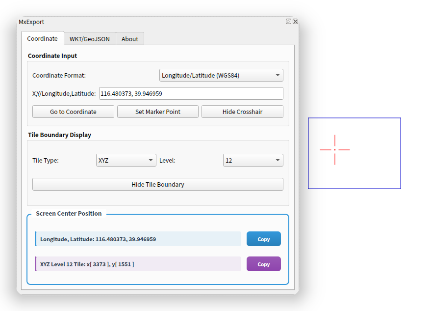
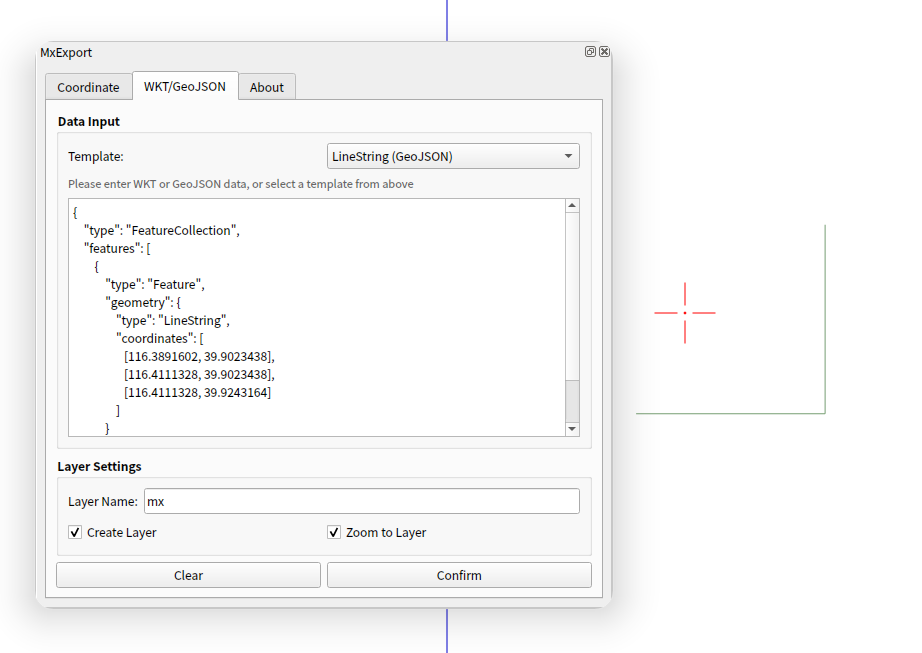

# MxExport QGIS 插件

MxExport 是专为 GIS 从业者开发的 QGIS 插件，提供坐标定位标记、NDS/XYZ/TMS 瓦片信息显示、WKT/GeoJSON 数据导入、图层管理等核心功能，简化地理信息处理流程，提升工作效率。

## 功能特性

### 🌍 坐标定位与标记
- 精确坐标定位，支持一键复制坐标
- 实时显示地图中心坐标
- 根据坐标格式自动切换输入标签（NDS TileID、XYZ Tile、TMS Tile、WGS84、EPSG:3857）
- 切换格式或平移地图时自动回显当前坐标
- 一键跳转到指定位置，并适配当前地图坐标系

### 🗺️ 瓦片信息与边界
- 支持 NDS、XYZ、TMS 瓦片，查看 x、y、z 参数
- 直观显示瓦片边界，便于空间分析
- 可调节缩放级别
- 直接输入 Tile 坐标快速跳转
- TMS 与 XYZ 共用 X、Z，Y 轴方向相反
- 坐标格式与瓦片面板类型一致时，平移地图按所选瓦片级别回显 Z

### ➕ 十字准线
- 屏幕中心十字准线可随时显示或隐藏，切换后立即刷新
- 两种样式：屏幕中心短十字，以及铺满屏幕的横竖线

### 📊 数据导入与图层管理
- 快速导入 WKT 与 GeoJSON，自动创建图层并显示几何
- 导入 GeoJSON 时保留 properties，可在图层属性表中查看和编辑
- 支持 Multi 几何、带内环的多边形以及 GeometryCollection
- 内置 WKT 编辑模板，便于快速标记和添加图层
- 图层创建窗口追踪，方便定位目标图层

## 更新日志

### v2.5
- ✨ **新增**：TMS 瓦片定位与边界显示。TMS 与 XYZ 共用 X、Z，Y 轴方向相反
- ✨ **新增**：坐标格式为 XYZ Tile 或 TMS Tile，且瓦片面板使用相同类型时，平移地图按所选瓦片级别回显 Z
- ✨ **新增**：两种十字准线样式，屏幕中心短十字，以及铺满屏幕的横竖线
- 🐛 **修复**：十字准线显示与隐藏后覆盖层立即刷新
- 🐛 **修复**：WKT/GeoJSON 导入时 Multi 几何、带内环多边形和 GeometryCollection 不再丢失部件
- 🎯 **改进**：调整坐标操作布局；WKT/GeoJSON 面板高度自适应并设最小高度，底部按钮保持可见

### v2.4
- 🐛 **修复**：关闭后再次打开插件无法使用的问题
- ✨ **增强**：图层渲染支持多实例输入
- 🎯 **优化**：瓦片边界显示效果

### v2.3
- 🎯 **改进**：界面布局与使用体验
- 🎯 **优化**：NDS、XYZ 瓦片坐标计算精度
- ✨ **增强**：多种 EPSG 坐标系兼容
- 🐛 **修复**：坐标显示与定位精度
- 🎯 **优化**：插件加载与数据处理速度

### v2.2
- ✨ **新增**：GeoJSON Properties 支持
  - 导入 GeoJSON 时自动保存 properties 数据
  - 在图层属性表中查看和编辑原始数据
- ✨ **新增**：动态坐标输入标签
  - 根据选择的坐标格式自动切换标签文本
  - 支持 NDS TileID、XYZ Tile、WGS84、EPSG:3857
- ✨ **新增**：坐标自动回显
  - 切换坐标格式时自动显示当前对应的坐标值
  - 地图范围改变时实时更新坐标显示
- ✨ **新增**：中文（简体/繁体）与日文界面翻译
- 🐛 **修复**：GeoJSON 处理的多处逻辑问题
  - 修复 shapely unary_union 的调用错误
  - 改进坐标系转换和符号样式设置

### v2.1
- ✨ **新增**：Tile坐标快速跳转功能
  - 支持通过输入X,Y坐标直接跳转到指定Tile
  - 支持NDS和XYZ两种Tile坐标系统
  - 自动适配当前地图坐标系（EPSG:4326、EPSG:3857等）
- 🐛 修复：EPSG:3857坐标系下WKT/GeoJSON导入跳转位置错误
- 🎯 改进：优化坐标系转换逻辑，确保在不同坐标系下的准确性

### v2.0
- ✨ 初始版本发布
- 🌍 坐标转换功能
- 🗺️ 瓦片边界显示
- 📊 WKT/GeoJSON数据支持

## 许可证

本项目采用 [Apache-2.0 license](LICENSE) - 详见LICENSE文件
